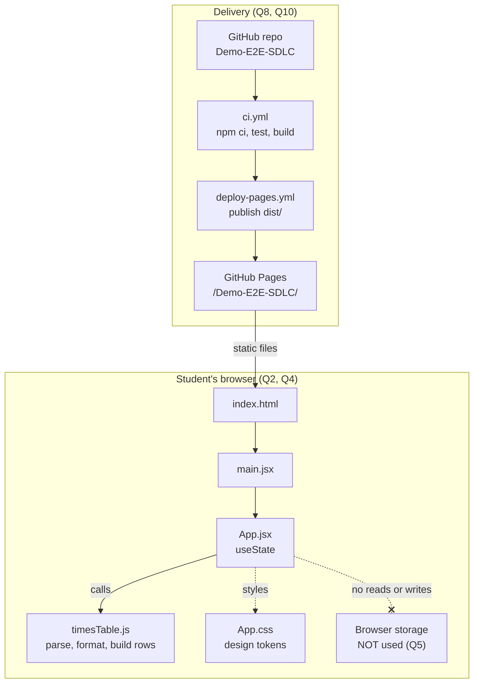

# Solution Design Document (Lite): Times Table Generator

## Overview

The Times Table Generator is a single-screen static web app for students aged 8 to 12. A student types a whole number from 1 to 100 and presses Generate or Enter. The app shows 10 rows, from "n × 1 = n" to "n × 10 = 10n". Any other entry shows "Please enter a whole number from 1 to 100.", clears the table and keeps the typed text. It is a proof of concept (POC) for a demo, not a production system (Q1). The chosen stack is plain React 18 with hooks and one CSS file, on the demo repo's starter template (Vite 5, Vitest 2 + Testing Library + jsdom). One `App` component holds the input, rows and error in `useState`. A pure module `timesTable.js` does validation, row formatting and table generation. One stylesheet, `App.css`, defines custom-property design tokens. CI runs on GitHub Actions, and `dist/` is deployed to GitHub Pages at https://shindesubodh.github.io/Demo-E2E-SDLC/ (Q8). There is no server, no storage and no sign-in (Q5, Q7).

## Questionnaire summary

| Q | Answer in brief | Design consequence |
|---|---|---|
| Q1 Application Nature | POC for a demo, one sprint, single-tenant | One screen and one component. There are no routing, theming or multi-tenant layers. |
| Q2 Users & Scale | A handful of demo users; phone and laptop at 360-1920 px; latest major browsers | Responsive CSS that works from a 360 px width. Only standard ES2020 and CSS custom properties, which all target browsers support. |
| Q3 Availability | Best effort on the Pages free tier; no SLA, RTO, RPO or monitoring | A static hosting build with no health checks. Rollback means redeploying the previous commit. |
| Q4 Performance | Result in under 100 ms; first load assumed under 2 s | All logic is synchronous and runs in the browser. There are no network calls and no extra runtime dependencies beyond React. |
| Q5 Security & Compliance | No PII, no storage, no auth; WCAG 2.1 AA basics | There is no storage contract. There are no cookies, analytics or third-party scripts. The design uses a linked label, a `role="alert"` region, visible focus and colours with 4.5:1 contrast. |
| Q6 AI | No AI at runtime | There are no AI SDKs or API keys. |
| Q7 Integrations | None at runtime | There is no API layer, no fetch code and no identity provider. |
| Q8 Infrastructure | GitHub Pages; existing `ci.yml` and `deploy-pages.yml` | Vite `base: '/Demo-E2E-SDLC/'`. The npm scripts `test` and `build` are kept. |
| Q9 Team & Operations | The Admin alone; the build agent writes the code; no monitoring | Simple code with pure functions that are easy to test. Operations means checking CI and the deployed URL by hand. |
| Q10 Budget & Timeline | Zero budget; open source only; 15 points in one sprint | No new paid or extra libraries. The scope stays within the 7 stories. |

## Architecture diagram



## Components

| Component (file) | Responsibility | Stories served |
|---|---|---|
| `index.html` | HTML shell with `lang="en"`, a viewport meta tag, the page title and the root div. | S6 |
| `src/main.jsx` | Mounts `<App />` in React 18 `createRoot` and imports `App.css`. | S1, S6 |
| `src/App.jsx` (`App`) | Renders the title, a form with a labelled input and the Generate button, the error region and the table list. Holds `inputValue`, `rows` and `error` state. On form submit, it calls `parseTableNumber` and `buildTable`. | S1, S2, S3, S4 |
| `src/timesTable.js` | Pure module with no React and no side effects. Named exports: `parseTableNumber(text)`, `buildTable(n)`, `formatRow(n, m)` and the `ERROR_MESSAGE` constant. `buildTable` calls `formatRow` to build each row's text. | S1, S2, S3 |
| `src/App.css` | Design tokens (`--color-*`, `--font-size-*`, `--space-*`, `--focus-ring`), a responsive layout and a 2 px focus outline. | S5, S6 |
| `src/timesTable.test.js` | Unit tests for parsing, row formatting and table generation. | S1, S3, S7 |
| `src/App.test.jsx` | Integration tests in jsdom covering the screen, keyboard use and accessibility. | S1-S4, S7 |
| `.github/workflows/ci.yml` | Runs `npm ci`, `npm test` and `npm run build` on pull requests and on pushes to main. | S7 |
| `.github/workflows/deploy-pages.yml` | Builds and publishes `dist/` to Pages on a merge to main. | S6, S7 |

## Data flow

Main action: the student types "7" and presses Generate or Enter.

1. The student types into `<input id="number-input">`. `onChange` stores the raw text in `inputValue` state. The text is not trimmed or changed, so it stays as typed (BR-03).
2. Pressing Enter in the input or clicking or activating Generate submits the `<form>`. `onSubmit` calls `event.preventDefault()`, so the page does not reload (Q4).
3. `App` calls `parseTableNumber(inputValue)`. The function trims the text, checks it against `/^[0-9]+$/`, converts it to a number and checks that 1 ≤ n ≤ 100.
4. If the result is `{ ok: true, value: 7 }`, `App` calls `buildTable(7)`, which calls `formatRow(7, m)` for m = 1 to 10 and returns 10 row objects. `App` sets `rows` to them and `error` to `''`. The new rows replace any old ones (S2).
5. If the result is `{ ok: false, error }`, `App` sets `rows` to `[]` and `error` to `ERROR_MESSAGE`. `inputValue` is left unchanged (S3).
6. Storage: nothing is read or written. No localStorage, sessionStorage or cookies are used (Q5, NFR-04).
7. React re-renders. The `<ol>` shows rows such as "7 × 1 = 7", or the `role="alert"` region shows the error, and screen readers announce it (S4). All work is synchronous and well under 100 ms (Q4).

## Interfaces and storage contract

There is no server API. The app makes no network calls at runtime (Q7). The only interfaces are the named exports of `src/timesTable.js` below; `App.jsx` and the tests import them.

| Export (module `src/timesTable.js`) | Inputs | Output | Errors |
|---|---|---|---|
| `parseTableNumber(text)` | `text: string` (raw input; `null` or `undefined` are treated as `''`) | `{ ok: true, value: number }` for 1-100; otherwise `{ ok: false, error: ERROR_MESSAGE }` | Never throws. An empty entry, spaces only, decimals, negatives, 0, numbers above 100, letters, symbols, a leading '+', inner spaces, commas and "1e2" all return `ok: false`. Leading zeros are accepted ("007" becomes 7, per A-02). |
| `buildTable(n)` | `n: integer` from 1 to 100 | An array of 10 `TableRow` objects, for multipliers 1 to 10, each with `text` from `formatRow(n, m)` | Throws `RangeError` if `n` is not an integer from 1 to 100. This is a programming guard: `App` only passes parsed values. |
| `formatRow(n, m)` | `n: integer` from 1 to 100 (the table number); `m: integer` from 1 to 10 (the multiplier) | The string `"n × m = p"` with p = n × m (1 to 1000), using U+00D7 and single spaces, e.g. `formatRow(7, 3)` returns `"7 × 3 = 21"` | Never throws. It does not validate ranges; callers (`buildTable`) only pass values in range. |
| `ERROR_MESSAGE` | — | `"Please enter a whole number from 1 to 100."` | — |

**Browser-storage contract:** none. The app defines no storage keys and has no JSON shape or version, because the scope has no saving or history (Q5, NFR-04). If storage is ever added, it needs a change request and a versioned key such as `ttg.v1`.

## Data model

No data is stored. These are the in-memory shapes only.

**AppState** (React state in `App`)

| Field | Type | Required | Description |
|---|---|---|---|
| `inputValue` | string | Yes | The raw text as typed. It is never trimmed in state. |
| `rows` | TableRow[] | Yes | Either 0 or 10 rows. It is `[]` at the start and after an error. |
| `error` | string | Yes | Either `''` or `ERROR_MESSAGE`. |

**TableRow**

| Field | Type | Required | Description |
|---|---|---|---|
| `multiplier` | number | Yes | 1-10. Also used as the React key. |
| `product` | number | Yes | n × multiplier. The largest value is 1000. |
| `text` | string | Yes | Output of `formatRow(n, multiplier)`, for example "7 × 3 = 21". |

**ParseResult**

| Field | Type | Required | Description |
|---|---|---|---|
| `ok` | boolean | Yes | Shows whether the entry is valid. |
| `value` | number | Only if `ok` is true | The integer from 1 to 100. |
| `error` | string | Only if `ok` is false | `ERROR_MESSAGE`. |

## Technology stack

| Layer | Choice | Version | Justification | Questionnaire ref |
|---|---|---|---|---|
| UI library | React with hooks (`useState`) | 18.x | It is part of the starter template. One component is enough for a single screen. | Q1, Q8 |
| Build tool | Vite | 5.x | It is part of the template. It produces a small static `dist/` with the base path set. | Q4, Q8 |
| Styling | One plain CSS file with custom properties | CSS3 | It needs no dependency and the tokens can be reused from the mockup. All target browsers support it. | Q2, Q10 |
| Logic | Plain JavaScript module (ES modules) | ES2020 | Pure functions that are easy to unit test and run with no network calls. | Q4, Q9 |
| Unit and integration tests | Vitest + @testing-library/react + @testing-library/user-event + jsdom | Vitest 2.x | Part of the template; runs under `npm test` in CI. `user-event` is used for keyboard tests (an open-source dev dependency only). | Q8, Q10 |
| CI | GitHub Actions `ci.yml` | — | Already in place and free. | Q8, Q10 |
| Hosting | GitHub Pages via `deploy-pages.yml` | Free tier | Mandated hosting, best effort, no cost. | Q3, Q8, Q10 |
| Runtime data and AI | None | — | No storage, no APIs, no AI. | Q5, Q6, Q7 |

## Repository structure

```
Demo-E2E-SDLC/
├── .github/
│   └── workflows/
│       ├── ci.yml                 (template, unchanged)
│       └── deploy-pages.yml       (template, unchanged)
├── index.html                     (template; set lang="en", viewport, title)
├── package.json                   (template; scripts kept; add @testing-library/user-event to devDependencies)
├── package-lock.json
├── vite.config.js                 (template; base '/Demo-E2E-SDLC/', test env jsdom)
└── src/
    ├── main.jsx                   (template; imports App.css)
    ├── App.jsx                    (template, replaced with the screen)
    ├── App.css                    (new: tokens and layout)
    ├── App.test.jsx               (template, replaced with integration tests)
    ├── timesTable.js              (new: pure logic; exports parseTableNumber, buildTable, formatRow, ERROR_MESSAGE)
    └── timesTable.test.js         (new: unit tests)
```

## Environment variables and build configuration

No environment variables are needed. There are no secrets, APIs, keys or per-environment settings (Q5, Q7). Do not create a `.env` file.

Build configuration in `vite.config.js`:

| Setting | Value | Reason |
|---|---|---|
| `base` | `'/Demo-E2E-SDLC/'` | Assets must load under the Pages project path (Q8). |
| `plugins` | `[react()]` | From the template. |
| `test.environment` | `'jsdom'` | Needed for the integration tests (Q8). |
| `test.globals` | `true` (as in the template) | Lets tests use Testing Library matchers. |

npm scripts are kept: `npm test` runs `vitest run` and `npm run build` runs `vite build`.

## Testing approach

All tests run with `npm test` in `ci.yml`. Test names are descriptive so the CI log lists them by name (S7).

| File | Type | What is tested | Stories |
|---|---|---|---|
| `src/timesTable.test.js` | Unit | `buildTable(7)` returns 10 rows from "7 × 1 = 7" to "7 × 10 = 70". | S1 |
| `src/timesTable.test.js` | Unit | `buildTable(1)` ends in "1 × 10 = 10" and `buildTable(100)` ends in "100 × 10 = 1000". | S1 |
| `src/timesTable.test.js` | Unit | `parseTableNumber(" 12 ")` returns 12 and "007" returns 7. | S1 |
| `src/timesTable.test.js` | Unit | Each of "", "   ", "2.5", "-3", "0", "101", "abc", "+5" and "7!" returns `ok: false` with the exact message (a table-driven `it.each`). | S3 |
| `src/timesTable.test.js` | Unit | `formatRow(7, 3)` returns "7 × 3 = 21" using U+00D7; `formatRow(100, 10)` returns "100 × 10 = 1000"; `buildTable(0)` throws `RangeError`. | S1 |
| `src/App.test.jsx` | Integration | Type 7 and click Generate: 10 list items appear. Type 7 and press Enter: the same rows appear. | S1 |
| `src/App.test.jsx` | Integration | The table for 7 is replaced by the table for 9, and no rows for 7 remain. An error clears after a valid entry. | S2 |
| `src/App.test.jsx` | Integration | An invalid entry shows the error, leaves no list items and keeps the input value exactly as typed. | S3 |
| `src/App.test.jsx` | Integration | `getByLabelText('Enter a number from 1 to 100')` finds the input. The error is inside `role="alert"`. Tab, typing and Enter alone (with `user-event`) generate a table, and Tab then Space on the button works too. | S4 |
| Manual (DoD) | Check | Contrast ratios of the tokens are at least 4.5:1, the focus outline is visible, the layout fits 360 px, and the deployed URL loads. | S5, S6, S7 |

Contrast and layout checks are manual because jsdom does not compute layout (Q9).

## ADRs

### ADR-1: Tech stack
- **Context:** The app must use the starter template (React 18 + Vite 5, Vitest) and keep its npm scripts and the Pages deployment (Q8). It is a one-screen POC with a zero budget (Q1, Q10).
- **Options considered:**
  1. Plain React with hooks and one CSS file. *(Chosen)*
  2. React with CSS Modules, plus split components (`NumberForm`, `TableList`, `ErrorMessage`).
  3. React with a utility CSS framework (Tailwind CSS).
- **Decision:** Option 1, chosen by the Admin.
- **Rationale:** It has the fewest files and dependencies for 15 points (Q10). Design tokens as CSS custom properties match the mockup handoff. The single-component code is easy for the Admin to review (Q9). It adds no network or font loading (Q4).
- **Consequences:** `App.jsx` holds all markup. If the scope grows, it should be split into components. Styles are global, which is acceptable for one screen.
- **Status:** Accepted

### ADR-2: State and validation design
- **Context:** The app must give results in under 100 ms (Q4), have testable validation for 9 or more invalid cases (S3), and keep the typed text after an error.
- **Options considered:**
  1. Pure `timesTable.js` module plus three `useState` values in `App`.
  2. `useReducer` with actions inside `App`.
  3. Native HTML validation (`type="number"`, `min`, `max`, `step`) with the browser's messages.
- **Decision:** Option 1, with a text input (`type="text"`, `inputMode="numeric"`) and a regex check.
- **Rationale:** Pure functions can be unit tested without React (Q9). `type="number"` loses the raw text: it accepts "1e2" and "+5", varies by browser, and shows its own messages in different wording, so it cannot guarantee the exact message (Q2). `useReducer` adds ceremony for three fields (Q10).
- **Consequences:** The app must set `noValidate` and use its own `role="alert"` region. Phones show a numeric keypad through `inputMode`.
- **Status:** Accepted

### ADR-3: No browser storage
- **Context:** There is no saving or history in scope, and no data is to be stored (Q5, NFR-04).
- **Options considered:**
  1. No storage; state is in memory only.
  2. localStorage holding the last number, under a versioned key.
  3. Encoding the number in the URL query or hash.
- **Decision:** Option 1.
- **Rationale:** It matches the scope and the privacy rule (Q5). Options 2 and 3 add features that are not in the BRD, and option 2 writes to the device.
- **Consequences:** Reloading the page resets the screen. There is no storage contract to version.
- **Status:** Accepted

## Sign-off

| Role | Name | Decision | Date |
|---|---|---|---|
| Approver (Sponsor, Product Owner) | Admin | Pending gate approval | — |

Status: **Pending gate approval** (Gate 3: SDD sign-off).
