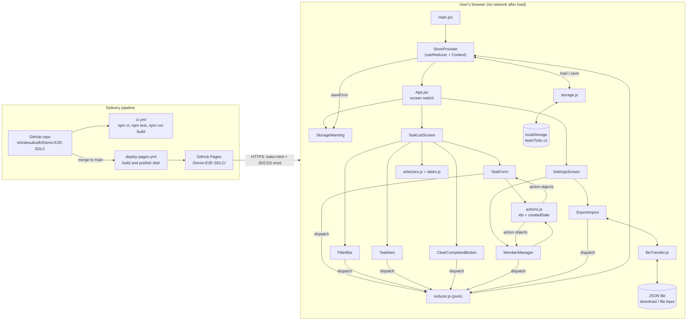

# Solution Design Document (Lite): Team To-Do Tracker

## Overview

Team To-Do Tracker is a static, front-end-only web app for one team of up to 10 people (P1 Team Lead/Admin, P2 Team Member). Users add, edit, delete, assign and tick off tasks. They filter the list by assignee and status, manage member names on a settings screen, and export or import the list as JSON. All data lives in the browser's localStorage. There is no server, database, sign-in or secret (Q5, Q7). The app is built on the demo repo's starter template: React 18 + Vite 5, with one `useReducer` for tasks and members shared through React Context, and a small storage module that syncs state to localStorage. Tests use Vitest 2 + Testing Library + jsdom. CI runs on GitHub Actions, and `dist/` deploys to GitHub Pages at https://shindesubodh.github.io/Demo-E2E-SDLC/ (Q8). Delivery is one sprint of 10 stories, 29 points (Q10).

## Questionnaire summary

| Q | Answer in brief | Design consequence |
|---|---|---|
| Q1 Application Nature | Production MVP, single-tenant, 12+ months | Versioned storage shape so later releases can migrate data |
| Q2 Users & Scale | Up to 10 users, 1 per browser, 500 tasks, 375px and 1280px, current Chrome/Safari/Firefox, local time zone | One responsive layout; native labelled controls; dates stored as local `YYYY-MM-DD`; week computed in local time |
| Q3 Availability & Reliability | No SLA; RTO < 30 min via revert; RPO = last JSON export | Revert-and-redeploy recovery; load never crashes on bad data; save errors shown as a warning; export is the backup |
| Q4 Performance | First load < 2 s; updates < 100 ms at 500 tasks; bundle < 100 KB gzipped | Memoised filter/sort selectors; no runtime libraries beyond React and ReactDOM |
| Q5 Security & Compliance | No auth; unencrypted local data; imports untrusted; no third parties | Full validation of imports; React escaping only, no `dangerouslySetInnerHTML`; no network calls |
| Q6 AI & Model Constraints | Not applicable | No AI components |
| Q7 Integration Landscape | None; browser APIs: localStorage, Blob download, file input | Storage module and file module wrap these browser APIs |
| Q8 Infrastructure & Deployment | GitHub Pages under `/Demo-E2E-SDLC/`; existing CI/CD; no router; no env vars | `base: '/Demo-E2E-SDLC/'`; workflows unchanged; screens switch through app state |
| Q9 Team & Operations | 1 developer; Admin owns ops; no runtime monitoring | Pure, unit-testable reducer and helpers; ids and dates are generated outside the reducer by action creators; checks rely on CI status and Definition of Done |
| Q10 Budget & Timeline | $0; open source only; 2-week sprint; drop S8 then S10 | Plain React; S8 and S10 isolated in their own components so they can be dropped cleanly |

## Architecture diagram



## Components

| Component (file) | Responsibility | Stories served |
|---|---|---|
| `src/main.jsx` | Mounts `<StoreProvider><App/></StoreProvider>` | All |
| `src/App.jsx` | Holds the `screen` state ('tasks' or 'settings') and renders the header nav, `StorageWarning` and the active screen (Q8) | All |
| `src/state/StoreContext.jsx` | `StoreProvider`: `useReducer(reducer, undefined, loadState)`; saves state on every change and keeps the last save result as `saveError` (string or null); exposes `useStore()` → `{ state, dispatch, saveError }` | S9, all |
| `src/state/actions.js` | Action creators that generate the impure values outside the reducer: `addTask` sets `id` with `crypto.randomUUID()` and `createdDate` with `todayISO()`; `addMember` sets the member `id` with `crypto.randomUUID()`. Both accept injected id and date for tests (Q9) | S1, S3 |
| `src/state/reducer.js` | Pure reducer for all task and member actions: no ids, dates or storage access inside; enforces title rules, 10-member limit and unique names (Q9) | S1-S5, S8, S10 |
| `src/state/selectors.js` | `selectVisibleTasks`, `memberName`, `countDone` (Q4) | S3, S6, S7, S8 |
| `src/lib/dates.js` | `todayISO`, `weekRange`, `isThisWeek`, `compareDue` (Q2) | S1, S6 |
| `src/lib/storage.js` | `loadState`, `saveState`, `validateData`; only module touching localStorage (Q5, Q7) | S9, S10 |
| `src/lib/fileTransfer.js` | `exportToFile`, `readImportFile` (Q7) | S10 |
| `src/components/StorageWarning.jsx` | Non-blocking banner with `role="status"` shown while `saveError` is set: "Changes could not be saved in this browser. Export your list to keep a copy." Hidden when the next save succeeds (Q3, Q5) | S9 |
| `src/components/TaskListScreen.jsx` | Composes form, filters, list, clear button; holds filter state; memoises visible list | S5, S6, S7 |
| `src/components/TaskForm.jsx` | Add and edit form: title (maxLength 120), assignee select, date input; inline error; builds actions with `addTask` | S1, S2, S4 |
| `src/components/TaskItem.jsx` | One row: done checkbox labelled with task title, assignee name, due date, "This week" badge, Edit, Delete with confirm | S2, S4, S5, S6 |
| `src/components/FilterBar.jsx` | Assignee select (All, Unassigned, members) and status select (Pending, Done, All) | S7 |
| `src/components/ClearCompletedButton.jsx` | Disabled when no Done tasks; confirm "Remove N completed tasks?" | S8 |
| `src/components/SettingsScreen.jsx` | Composes member manager and export/import | S3, S10 |
| `src/components/MemberManager.jsx` | Add (via `addMember`), rename, remove members; shows "Maximum 10 team members" | S3 |
| `src/components/ExportImport.jsx` | Export button; file input; replace-warning confirm; error message | S10 |
| `src/styles.css` | Design tokens (CSS custom properties from Phase 4 mockup), responsive layout, focus styles | All (NFR-01, NFR-02) |

## Data flow

Main action: add and assign a task (S1, S4).

1. The user types a title, picks an assignee from the select (members from `state.members`, plus 'Unassigned') and optionally a due date in `TaskForm`.
2. On submit, `TaskForm` trims the title. If it is empty, it shows the error next to the field and stops.
3. `TaskForm` calls `addTask({ title, assigneeId, dueDate })` from `actions.js`. It returns `{ type: 'task/add', payload: { task: { id: crypto.randomUUID(), title, assigneeId, dueDate, status: 'Pending', createdDate: todayISO() } } }`. `TaskForm` dispatches this action (Q9).
4. `reducer` stays pure: it re-validates the title (1-120 characters) and that the id is not already used, then returns a new state with `payload.task` appended. An invalid payload returns the same state.
5. `StoreProvider` re-renders. Its `useEffect([state])` calls `saveState(state)`, which writes `JSON.stringify({ version: 1, ...state })` to `localStorage['teamTodo.v1']`. A thrown `QuotaExceededError` or `SecurityError` is caught and returned as `{ ok: false, error }`. `StoreProvider` stores it in `saveError`, and `StorageWarning` shows the non-blocking banner until a later save succeeds (Q3, Q5).
6. `TaskListScreen` recomputes `useMemo(() => selectVisibleTasks(state, filters, today))`: filter by status and assignee, then sort by due date (no date last) (Q4).
7. `TaskItem` renders the new row with the member name via `memberName(state, assigneeId)` and a "This week" badge if `isThisWeek(dueDate, today)`. Focus returns to the title field for the next task.

## Interfaces and storage contract

There is no server API. All interfaces are in-browser module functions (Q7, Q8).

### Module functions

| Function (module) | Inputs | Output | Errors |
|---|---|---|---|
| `addTask(fields, opts?)` (actions.js) | `{ title, assigneeId, dueDate }`; optional `{ id, today }` for tests | `task/add` action with a full `Task` (UUID id, status 'Pending', createdDate = today) | none |
| `addMember(name, opts?)` (actions.js) | name string; optional `{ id }` for tests | `member/add` action with `{ id: crypto.randomUUID(), name }` | none |
| `reducer(state, action)` (reducer.js) | `AppState`, action (below) | New `AppState` | Invalid actions return the same state; components validate first for messages |
| `loadState()` (storage.js) | none | `AppState`; empty state `{ tasks: [], members: [] }` if missing, unreadable or invalid | Never throws (S9) |
| `saveState(state)` (storage.js) | `AppState` | `{ ok: true }` or `{ ok: false, error }` | Catches storage exceptions; caller shows `StorageWarning` |
| `validateData(obj)` (storage.js) | unknown | `{ ok: true, data: AppState }` or `{ ok: false, error: string }` | Never throws |
| `exportToFile(state)` (fileTransfer.js) | `AppState` | Downloads `team-todo-YYYY-MM-DD.json` via Blob + object URL, with `exportedAt` added | none |
| `readImportFile(file)` (fileTransfer.js) | `File` | `Promise<{ ok, data | error }>`; uses `file.text()`, `JSON.parse`, `validateData` | Non-JSON or invalid → `{ ok: false, error: 'This file is not a valid Team To-Do export.' }` |
| `selectVisibleTasks(state, filters, today)` (selectors.js) | `filters: { status: 'Pending'|'Done'|'All', assignee: 'All'|'Unassigned'|memberId }` | Sorted `Task[]` | none |
| `memberName(state, id)` (selectors.js) | member id or null | Name or `'Unassigned'` | none |
| `weekRange(today)` / `isThisWeek(due, today)` (dates.js) | `YYYY-MM-DD` strings | `{ start, end }` Monday-Sunday / boolean | Null due → false |

Reducer actions (all values arrive in the payload; the reducer generates none): `task/add { task }`, `task/update { id, title, assigneeId, dueDate }` (createdDate unchanged), `task/delete { id }`, `task/setStatus { id, status }`, `task/clearCompleted`, `member/add { member: { id, name } }` (blocked at 10, duplicate name or duplicate id), `member/rename { id, name }`, `member/remove { id }` (tasks keep the id and render 'Unassigned'), `data/replace { data }` (import).

### Storage contract

| Key | Value |
|---|---|
| `teamTodo.v1` | JSON string of the shape below. The export file uses exactly the same shape, plus `exportedAt` (Q3, Q5) |

```json
{
  "version": 1,
  "exportedAt": "2026-11-20T09:15:00.000Z",
  "members": [{ "id": "3f2a8c1e-6b4d-4e0a-9c7f-2d1b5e8a4f60", "name": "Priya" }],
  "tasks": [{
    "id": "91c07d2b-4a3e-4f8b-b6c5-0e9d1a2f3b74", "title": "Book team room",
    "assigneeId": "3f2a8c1e-6b4d-4e0a-9c7f-2d1b5e8a4f60",
    "dueDate": "2026-11-21", "status": "Pending", "createdDate": "2026-11-18"
  }]
}
```

Versioning rules (Q1): `version` must equal 1; a higher version is rejected with an error. A future v2 adds a migration function in `storage.js`. `exportedAt` is written only by `exportToFile`, never by `saveState`, and is ignored (dropped) on load and import. Validation rejects the whole payload if any field breaks the data model, more than 10 members exist, or ids repeat (Q5). Validation requires ids to be non-empty strings; it does not require UUID format, so hand-edited files with unique ids still import.

## Data model

### AppState (stored document and export file)

| Field | Type | Required | Description |
|---|---|---|---|
| version | number (1) | Yes (stored and exported) | Schema version |
| exportedAt | string (ISO 8601 date-time, UTC) | No (export file only) | Time the file was exported, from `new Date().toISOString()`. Not in localStorage; ignored on load and import (Q1, Q3) |
| tasks | Task[] | Yes | Up to 500 expected (Q4) |
| members | Member[] | Yes | 0-10 members |

### Task

| Field | Type | Required | Description |
|---|---|---|---|
| id | string | Yes | UUID from `crypto.randomUUID()`, generated by `addTask` in `actions.js` before dispatch; unique |
| title | string | Yes | Trimmed, 1-120 characters |
| assigneeId | string or null | No | Member id; null or unknown id renders 'Unassigned' |
| dueDate | string `YYYY-MM-DD` or null | No | Local date, no time zone (Q2) |
| status | 'Pending' or 'Done' | Yes | Default 'Pending' |
| createdDate | string `YYYY-MM-DD` | Yes | Set by `addTask` with `todayISO()` before dispatch, never changed |

### Member

| Field | Type | Required | Description |
|---|---|---|---|
| id | string | Yes | Stable UUID from `crypto.randomUUID()`, generated by `addMember` in `actions.js` before dispatch, so renames apply everywhere (Q7) |
| name | string | Yes | Trimmed, 1-40 characters, unique case-insensitive |

## Technology stack

| Layer | Choice | Version | Justification | Questionnaire ref |
|---|---|---|---|---|
| UI framework | React | 18.x | Template stack; chosen option; ~45 KB gzipped with ReactDOM | Q8, Q10 |
| State | `useReducer` + Context, with action creators | React 18 | No extra library; pure reducer is easy to test | Q4, Q9, Q10 |
| Build tool | Vite | 5.x | Template; fast builds; `base` for Pages sub-path | Q8 |
| Persistence | localStorage via `storage.js` | Browser API | No server allowed; synchronous and small | Q5, Q7 |
| IDs | `crypto.randomUUID()` | Browser API | Built into current Chrome, Safari, Firefox on HTTPS; no library | Q2, Q4, Q8 |
| File transfer | Blob + object URL, `<input type="file">` | Browser API | Works in current Chrome, Safari, Firefox | Q2, Q7 |
| Styling | Plain CSS with custom properties | n/a | No external fonts or libraries; tokens from Phase 4 | Q4, Q5 |
| Testing | Vitest + Testing Library + jsdom | 2.x / latest / latest | Template; covers reducer and UI | Q9 |
| CI | GitHub Actions `ci.yml` | n/a | Existing; free | Q8, Q10 |
| Hosting | GitHub Pages via `deploy-pages.yml` | n/a | Existing; $0; static | Q3, Q8, Q10 |

## Repository structure

```text
Demo-E2E-SDLC/
├── .github/
│   └── workflows/
│       ├── ci.yml                     (template, unchanged)
│       └── deploy-pages.yml           (template, unchanged)
├── index.html                         (template; title set to "Team To-Do Tracker")
├── package.json                       (template; scripts unchanged)
├── vite.config.js                     (template; base '/Demo-E2E-SDLC/', test env jsdom)
└── src/
    ├── main.jsx                       (template; wraps App in StoreProvider)
    ├── App.jsx                        (template; replaced with screen switch)
    ├── App.test.jsx                   (template; integration tests)
    ├── styles.css                     (new)
    ├── test/
    │   └── setup.js                   (new; jest-dom matchers, localStorage reset)
    ├── state/
    │   ├── StoreContext.jsx           (new)
    │   ├── actions.js                 (new)
    │   ├── actions.test.js            (new)
    │   ├── reducer.js                 (new)
    │   ├── reducer.test.js            (new)
    │   ├── selectors.js               (new)
    │   └── selectors.test.js          (new)
    ├── lib/
    │   ├── dates.js                   (new)
    │   ├── dates.test.js              (new)
    │   ├── storage.js                 (new)
    │   ├── storage.test.js            (new)
    │   ├── fileTransfer.js            (new)
    │   └── fileTransfer.test.js       (new)
    └── components/
        ├── StorageWarning.jsx         (new)
        ├── TaskListScreen.jsx         (new)
        ├── TaskForm.jsx               (new)
        ├── TaskForm.test.jsx          (new)
        ├── TaskItem.jsx               (new)
        ├── TaskItem.test.jsx          (new)
        ├── FilterBar.jsx              (new)
        ├── ClearCompletedButton.jsx   (new)
        ├── ClearCompletedButton.test.jsx (new)
        ├── SettingsScreen.jsx         (new)
        ├── MemberManager.jsx          (new)
        ├── MemberManager.test.jsx     (new)
        ├── ExportImport.jsx           (new)
        └── ExportImport.test.jsx      (new)
```

## Environment variables and build configuration

No environment variables are needed. The app has no server, API keys or secrets, and behaves the same in every environment (Q5, Q8).

| Setting | Value | Reason |
|---|---|---|
| `vite.config.js` `base` | `'/Demo-E2E-SDLC/'` | Pages serves the project under the repo name; avoids 404 assets (Q8, A-08) |
| `vite.config.js` `test` | `{ environment: 'jsdom', setupFiles: './src/test/setup.js' }` | Testing Library needs a DOM (Q9) |
| npm scripts | `dev`, `build`, `test` (`vitest run`) kept as in template | CI depends on them (Q8) |
| Runtime dependencies | `react`, `react-dom` only | Bundle < 100 KB gzipped (Q4) |

## Testing approach

Unit tests cover pure logic without the DOM; integration tests render the app with Testing Library and act through labels and roles (Q9). Each test file resets localStorage. Dates use an injected `today` or `vi.setSystemTime`; ids use injected values or a stubbed `crypto.randomUUID`.

| Test file | Level | What is tested | Stories |
|---|---|---|---|
| `actions.test.js` | Unit | `addTask` sets a UUID id, status 'Pending' and today's createdDate (fixed date); `addMember` sets a UUID id and trimmed name; injected id and date are used | S1, S3 |
| `reducer.test.js` | Unit | add stores the payload task unchanged (same input gives same output), title rules, duplicate id rejected; update keeps createdDate, delete, setStatus, clearCompleted keeps Pending, member add limit 10 and duplicates, rename, remove → assigneeId orphaned, data/replace | S1-S5, S8, S10 |
| `selectors.test.js` | Unit | status/assignee/'Unassigned'/combined filters; sort with no-date last; `memberName` fallback; 500-task filter timed < 100 ms with `performance.now()` | S3, S6, S7 |
| `dates.test.js` | Unit | Monday-Sunday range for a Monday, a Wednesday, a Sunday, year boundary; `isThisWeek` edges | S6 |
| `storage.test.js` | Unit | round-trip save/load; missing, corrupt JSON, wrong version → empty state; `setItem` throwing is caught and returns `{ ok: false }`; `exportedAt` dropped on load | S9, S10 |
| `fileTransfer.test.js` | Unit | valid file parses; non-JSON and invalid shape return error; export builds Blob with version 1 and an ISO `exportedAt` | S10 |
| `TaskForm.test.jsx` | Integration | empty title error, maxLength 120, assignee options incl. only 'Unassigned' when no members | S1, S4 |
| `TaskItem.test.jsx` | Integration | checkbox label names task, keyboard toggle, "This week" text badge, delete confirm/cancel, edit | S2, S5, S6 |
| `MemberManager.test.jsx` | Integration | add, "Maximum 10 team members", rename reflects on tasks, remove shows 'Unassigned' | S3 |
| `ClearCompletedButton.test.jsx` | Integration | disabled with none; "Remove 3 completed tasks?"; confirm/cancel (mocked `window.confirm`) | S8 |
| `ExportImport.test.jsx` | Integration | replace warning, valid import replaces, invalid shows error and keeps list | S10 |
| `App.test.jsx` | Integration | default view Pending only and sorted; filters; data survives unmount/remount (reload); screen switch; `StorageWarning` appears when `localStorage.setItem` throws and the app keeps working | S5-S7, S9 |

Manual checks in Phase 6: the timed add-and-assign test at 1280px and 375px (NFR-07), Safari date input and download, cross-browser layout and contrast per the Definition of Done.

## ADRs

### ADR-1: Tech stack

- **Context:** Static app on the template (React 18 + Vite 5, Vitest, Pages), one developer, 2 weeks, $0, bundle < 100 KB, updates < 100 ms (Q4, Q8, Q9, Q10).
- **Options considered:**
  1. Plain React with `useReducer` + Context and a small localStorage module.
  2. React with Zustand and its `persist` middleware.
  3. React with Redux Toolkit and a localStorage listener middleware.
- **Decision:** Option 1, chosen by the Admin.
- **Rationale:** No new dependency, smallest bundle, pure reducer is directly unit-testable, and one store with 2 entities does not need a library (Q4, Q9, Q10).
- **Consequences:** Persistence, selectors and action creators are hand-written (small). Ids and dates are generated in action creators so the reducer stays pure. Context re-renders all consumers on change; acceptable at 500 tasks with memoised selectors (Q4).
- **Status:** Accepted

### ADR-2: Storage and export format

- **Context:** Data must survive reloads, survive bad stored data, and copy between devices; imports are untrusted (Q3, Q5, Q7).
- **Options considered:**
  1. One versioned JSON document in a single localStorage key, same shape as the export file.
  2. Separate keys for tasks and members, with a separate export format.
  3. IndexedDB with one record per task.
- **Decision:** Option 1, key `teamTodo.v1`, `version: 1`; the export file adds only the optional `exportedAt`.
- **Rationale:** One shape means one validator for load and import; atomic writes avoid tasks and members going out of step; 500 tasks are ~100 KB, well under the ~5 MB quota; IndexedDB is async and heavier to test (Q4, Q5, Q9).
- **Consequences:** Whole document rewritten on each change (fast at this size). A failed write is shown by `StorageWarning`, not hidden. Future schema changes need a migration in `storage.js` (Q1).
- **Status:** Accepted

### ADR-3: Members referenced by ID

- **Context:** Renames must show on all tasks; removed members' tasks show 'Unassigned' (Q2, Q7).
- **Options considered:**
  1. Tasks store a stable `assigneeId`; name looked up at render.
  2. Tasks store the member name as text; rename rewrites matching tasks.
  3. Tasks store the id and remove sets `assigneeId` to null in every task.
- **Decision:** Option 1, with member ids from `crypto.randomUUID()` in `addMember`; on remove, ids are left and resolve to 'Unassigned'.
- **Rationale:** Rename is one change; no bulk task rewrite; duplicate or edited names cannot mis-assign tasks; UUIDs make ids unique across devices that exchange files (Q4, Q7).
- **Consequences:** Orphan ids remain in data; the assignee filter treats unknown ids as 'Unassigned', and editing such a task saves null.
- **Status:** Accepted

## Sign-off

| Role | Name | Decision | Date |
|---|---|---|---|
| Sponsor, Product Owner and approver | The Admin | Pending gate approval | Pending |

**Status:** Pending gate approval
